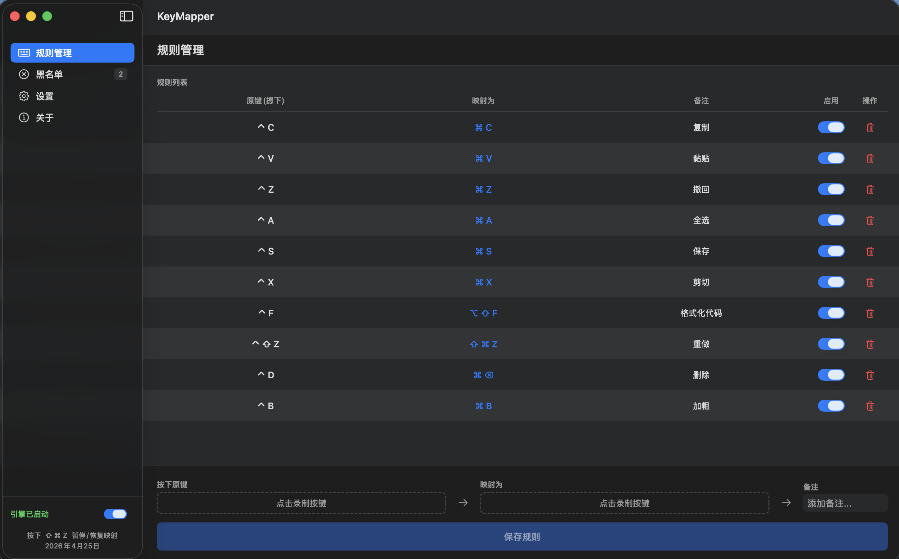

# KeyMapper for macOS

  

  <b>A lightweight macOS key remapping tool for Mac users</b> 
  <b>轻量级 macOS 按键映射工具，专为 Mac 用户打造</b>

  <a href="#english-version">English</a> | <a href="#中文版本">中文</a>

---

  

---

## English Version

### 🎯 What is KeyMapper?

KeyMapper is a lightweight macOS app designed for Windows users who struggle with macOS keyboard shortcuts. After years of using `Ctrl+C/V`, switching to `Command+C/V` can be frustrating. KeyMapper solves this by mapping Windows-style shortcuts to macOS equivalents **without** breaking other Command-based shortcuts.

### ✨ Features

- **🌍 Global Interception**: Uses low-level `CGEventTap` for system-wide key remapping
- **🎬 Visual Recording**: No need to look up keycodes—just click "Record" and press your desired key
- **⌨️ Modifier Support**: Full support for `⌘ Command`, `⌥ Option`, `⇧ Shift`, and `⌃ Control` combinations
- **🔁 Modifier Key Remapping**: Remap or swap Control, Option, Shift and Command, including held keys and mouse combinations
- **🎡 Radial Wheel**: When a key has multiple mappings, a beautiful radial wheel appears for quick selection
- **⏯️ Pause Hotkey**: Global hotkey (default: `⇧⌘Z`) to instantly pause/resume the engine
- **📊 Status Feedback**: Status bar icon dims when engine is paused for visual feedback
- **🚫 App Blacklist**: Disable key mapping in specific applications (e.g., Terminal)
- **🔇 Disable Keys**: Choose “Disable Key” in the target key selector, then use the rule's app whitelist to block a key only in selected apps
- **🎭 Stealth Mode**: Hide Dock icon and enable "Launch at Login" for seamless background operation
- **🔄 Import/Export**: Backup and restore your mapping rules with JSON files
- **🔍 Automatic Updates**: Checks GitHub after launch, at most once every 24 hours, and automatically downloads and verifies new versions. Click **Restart and Update** when ready to replace the app in its current location and relaunch it; rules and settings are preserved. Automatic checks and downloads have separate switches in Settings > General (both enabled by default). Background checks never open the main window. Manual checks and the releases page remain available
- **🔒 Privacy First**: 100% open-source, no analytics; network access is limited to GitHub update checks and update downloads, both of which can be disabled in Settings

### 🎡 Radial Wheel

When you have multiple mappings for the same key combination, KeyMapper shows a beautiful radial wheel selector:

  

- **Instant Selection**: Hold the key, move mouse to select, release to execute
- **Liquid Glass Effect**: Beautiful translucent glass effect on macOS 26+
- **Quick Animation**: Fast spring animation for responsive feel
- **ESC to Cancel**: Press ESC to dismiss without executing any mapping

### 🚀 Getting Started

#### Requirements
- macOS 13.5 or later
- Apple Silicon or Intel Mac

#### Installation

1. **Download**: Grab the latest release from the [Releases](../../releases) page
2. **Install**: Move `KeyMapper.app` to your `Applications` folder
3. **Grant Permissions** (Required):
   - Go to **System Settings > Privacy & Security > Accessibility**
   - Toggle **KeyMapper** to **ON**
   - This permission is required for the engine to intercept keystrokes
4. **First Run**: If macOS warns about an "unverified developer," right-click the app and select **Open**

#### Usage

1. **Create a Mapping**:
   - Click "Press Original Key" and press the key you want to remap (e.g., `Ctrl+C`)
   - Click "Map To" and press the target key (e.g., `Command+C`)
   - Click "Save Rule"

2. **Multiple Mappings**:
   - Create multiple mappings for the same key (e.g., `Ctrl+C` → `Command+C` and `Ctrl+C` → `Option+C`)
   - When you press and hold the key, a radial wheel appears
   - Move your mouse to select the desired mapping
   - Release to execute

3. **Pause/Resume Engine**:
   - Use the global hotkey `⇧⌘Z` (Shift+Command+Z) to toggle
   - Or click the status bar icon and select Pause/Resume

4. **Manage Blacklist**:
   - Go to Blacklist page
   - Add apps where you want to disable key mapping

5. **Backup & Restore**:
   - Go to Settings page
   - Click "Export Mapping Rules" to backup
   - Click "Import Config" to restore

#### Remap or swap modifier keys

In **Mapping Rules**, use the existing recording fields: press and release a modifier by itself to record it, then record the target modifier and save. For example, add `Control → Command`; to swap them, also add `Command → Control`. The visual key picker also accepts a modifier without a main key. A modifier can also map to a regular key or shortcut (for example, `Option → Command+V`), and a regular key or shortcut can map to a modifier. These rules show a dismissible usage tip below the rule; dismissals are saved. Modifier rules appear in the same list, with the usual notes, enable switches and app exclusions. Both physical sides are mapped while preserving their side.

Shortcut rules take priority and match the original physical keys. Other keyboard and mouse events carry the remapped modifiers. The pause hotkey always uses physical keys, so it remains available after a swap. Caps Lock and Fn are not remapping targets in this version.

Expand a rule to manage its **Blacklist** on the left and **Whitelist** on the right. Select a column heading to activate either blacklist or whitelist mode. Only the selected mode applies; both app lists are saved. An empty whitelist disables the rule. Adding an app activates its column. The global blacklist still takes priority. Click either keycap to edit it directly; click the card background to expand or collapse details.

To block a key only in XMind, record the source key, open the target key selector using its keyboard button, select **Disable Key**, confirm and save. Expand the rule and add XMind to its **Whitelist**. The key works normally in other apps. The blacklist excludes an app from the rule; it does not block the key.

Exports and backups use format 5.0, including key blocking actions, per-rule application scopes and modifier rules. Formats 2.0, 3.0 and 4.0 can still be imported with their existing behavior; importing format 2.0 without modifier rules clears modifier rules. Older app versions cannot import format 5.0. Test the full press/hold/release sequence with your remote desktop client before relying on it.

### 🛠 Technical Details

- **Architecture**: SwiftUI + AppKit hybrid
- **Event Interception**: CoreGraphics `CGEventTap` API
- **Storage**: UserDefaults + JSON serialization
- **Sandboxing**: Distributed without Sandbox (required for global event interception)

---

## 中文版本

### 🎯 KeyMapper 是什么？

KeyMapper 是一款专为 Windows 用户设计的轻量级 macOS 按键映射工具。用惯了 `Ctrl+C/V` 的用户，切换到 Mac 的 `Command+C/V` 总是不太顺手。使用 KeyMapper 可以地将 Windows 风格的快捷键映射到 macOS 等效快捷键，**同时不影响**其他基于 Command 的快捷键使用。

### ✨ 功能特性

- **🌍 全局拦截**：利用底层 `CGEventTap` 技术，实现系统级按键重映射
- **🎬 可视化录制**：无需记忆键位码，点击录制按钮后直接敲击键盘即可自动识别
- **⌨️ 组合键支持**：完美支持 `⌘ Command`、`⌥ Option`、`⇧ Shift`、`⌃ Control` 的任意组合
- **🔁 修饰键映射**：支持 Control、Option、Shift、Command 的单向映射与互换，持续按住及鼠标组合操作同步生效
- **🎡 轮转转盘**：同一按键有多个映射时，弹出精美轮盘供快速选择
- **⏯️ 暂停快捷键**：全局快捷键（默认：`⇧⌘Z`）快速暂停/恢复引擎
- **📊 状态反馈**：引擎暂停时状态栏图标变淡，直观显示当前状态
- **🚫 应用黑名单**：在特定应用中禁用按键映射（如终端）
- **🔇 禁用按键**：在目标按键选择器中选择“禁用按键”，配合规则白名单，仅在指定应用中屏蔽按键
- **🎭 静默运行**：支持隐藏 Dock 图标、开机自启动，满足无感化后台运行需求
- **🔄 导入导出**：支持备份和恢复映射规则
- **🔍 自动更新**：启动后自动检查 GitHub，每 24 小时最多一次，发现新版本后自动下载并校验。点击「重启并更新」后，在原位置替换应用并重新启动，保留规则和设置。「设置 → 通用设置」提供独立的自动检查、自动下载开关，默认均开启。后台检查不会打开主窗口，仍可手动检查或前往发布页下载
- **🔒 完全开源**：不包含统计模块，网络连接仅用于 GitHub 更新检查和更新包下载，可在设置中关闭自动检查及下载，保护输入隐私

### 🎡 轮转转盘

当同一按键组合有多个映射时，KeyMapper 会显示一个精美的轮转转盘选择器：

  

- **即时选择**：按住按键，移动鼠标选择，松手执行
- **液态玻璃效果**：macOS 26+ 上呈现精美的半透明玻璃效果
- **快速动画**：流畅的弹性动画，响应迅速
- **ESC 取消**：按 ESC 键可取消本次操作

### 🚀 快速开始

#### 系统要求
- macOS 13.5 或更高版本
- Apple Silicon 或 Intel Mac

#### 安装步骤

1. **下载**：在 [Releases](../../releases) 页面下载最新版本
2. **安装**：将 `KeyMapper.app` 拖入「应用程序」文件夹
3. **授权**（必须）：
   - 打开「系统设置 > 隐私与安全性 > 辅助功能」
   - 找到 `KeyMapper` 并打开开关
   - 此权限是引擎捕获和修改按键信号的必要条件
4. **首次运行**：由于未经过 Apple 公证，首次运行请**右键点击**图标并选择「打开」

#### 使用方法

1. **创建映射规则**：
   - 点击「按下原键」，按下想要映射的键（如 `Ctrl+C`）
   - 点击「映射为」，按下目标键（如 `Command+C`）
   - 点击「保存规则」

2. **多映射选择**：
   - 为同一按键创建多个映射（如 `Ctrl+C` → `Command+C` 和 `Ctrl+C` → `Option+C`）
   - 按住按键时，轮转转盘会弹出
   - 移动鼠标选择想要的映射
   - 松手执行

3. **暂停/恢复引擎**：
   - 使用全局快捷键 `⇧⌘Z`（Shift+Command+Z）切换
   - 或点击状态栏图标，选择暂停/恢复

4. **管理黑名单**：
   - 进入黑名单页面
   - 添加不想启用映射的应用

5. **备份与恢复**：
   - 进入设置页面
   - 点击「导出映射规则」进行备份
   - 点击「导入配置」进行恢复

#### 修饰键映射与互换

在原有 **映射规则** 页直接录制：单独按下并松开一个修饰键即可录入，再录制目标修饰键并保存。例如添加 `Control → Command`；需要互换时，再添加 `Command → Control`。可视化选择器也支持只选修饰键、不选主键。也可以设置 `Option → Command+V` 这类修饰键与普通键/组合键之间的映射；规则下方会显示可关闭的使用习惯提示，关闭状态会保存。修饰键映射与普通快捷键显示在同一列表，共用备注、启停开关与应用黑名单。左右键同时生效并保留侧别。

快捷键规则优先匹配原始物理按键，其余键盘和鼠标事件携带映射后的修饰键。暂停热键始终按物理键触发，互换后仍可使用。本版本不提供 Caps Lock 或 Fn 的映射。

展开规则后，左侧管理 **黑名单**，右侧管理 **白名单**，点击栏标题选择黑名单或白名单模式，只有所选模式生效，两份应用列表都会保留。白名单为空时规则不生效；添加应用会启用对应栏。全局黑名单仍然优先。直接点击键帽即可编辑按键，点击卡片背景可展开或收起详情。

如需仅在 XMind 中屏蔽某个按键，先录入来源按键，点击目标栏的键盘按钮，选择 **禁用按键** 并确认保存；展开该规则，在 **白名单** 中添加 XMind。其他应用中的按键保持正常。黑名单表示不执行这条规则，不表示屏蔽按键。

导出与备份使用 5.0 格式，包含禁用按键操作、单条规则的应用生效范围和修饰键规则；仍可导入 2.0、3.0、4.0 格式并保留原有行为。导入不含修饰键规则的 2.0 格式会清空修饰键规则。旧版应用无法导入 5.0 格式。远程桌面请先在实际客户端验证按下、持续按住和松开的完整行为。

### 🛠 技术细节

- **架构**：SwiftUI + AppKit 混合
- **事件拦截**：CoreGraphics `CGEventTap` API
- **数据存储**：UserDefaults + JSON 序列化
- **沙盒**：非沙盒模式分发（全局事件拦截必需）

---

## License / 许可证

Copyright (C) 2026 baikaihao.

KeyMapper is licensed under the **GNU Affero General Public License, version 3 only** (`AGPL-3.0-only`). You may use, modify, and distribute it, including commercially, under the terms of this license. When distributing covered software, provide its Corresponding Source as required by the license. If you modify the software and your version supports remote network interaction, you must prominently offer those users access to the Corresponding Source of your version at no charge.

This software is provided without any warranty. See [LICENSE](LICENSE) for the complete terms.

KeyMapper 采用 **GNU Affero 通用公共许可证第 3 版（仅此版本）**（`AGPL-3.0-only`）。允许在遵守许可证的前提下使用、修改、分发及商业使用。分发受该许可证覆盖的软件时，须按许可证要求提供对应源码；如果修改版支持通过网络远程交互，须向这些用户显著提供免费获取该修改版对应源码的途径。

本软件不提供任何担保。完整条款见 [LICENSE](LICENSE)。

## Publishing automatic updates / 发布自动更新

Attach a universal ZIP named `KeyMapper.app.zip` (or `KeyMapper.zip`) containing `KeyMapper.app` at the archive root to each GitHub Release. The app version must match the release tag (an optional `v` prefix is supported), and the bundle identifier must remain `bkh.KeyMapper`. Keep the app's code signature intact. The updater verifies GitHub's SHA-256 asset digest, bundle identity, version, supported macOS version and CPU architecture before installation. Developer ID signed installations also require the existing signing identity to match. Packages without a SHA-256 digest fall back to the releases page.

每次发布 GitHub Release 时，上传名为 `KeyMapper.app.zip`（或 `KeyMapper.zip`）的通用 ZIP 包，根目录直接包含 `KeyMapper.app`。应用版本需与 Release 标签一致（允许 `v` 前缀），Bundle ID 保持 `bkh.KeyMapper`，并保留完整应用签名。更新器会校验 GitHub 提供的 SHA-256、应用身份、版本、macOS 和处理器兼容性；Developer ID 签名的安装还会检查签名身份一致。缺少 SHA-256 的附件会退回发布页手动下载。

The installation directory must be writable. Move the app out of a disk image and into Applications before updating. The previous app is kept until the new version launches, and a failed replacement or launch request triggers rollback. Updating only replaces the app bundle; it does not modify rule files or preferences.

应用所在目录需要可写，请先将应用从磁盘映像拖入「应用程序」文件夹。旧应用会保留到新版启动；替换或启动请求失败时尝试回滚。更新只替换应用包，不修改规则文件和偏好设置。

## 📝 Changelog

See [CHANGELOG.md](other/CHANGELOG.md) for release history.
